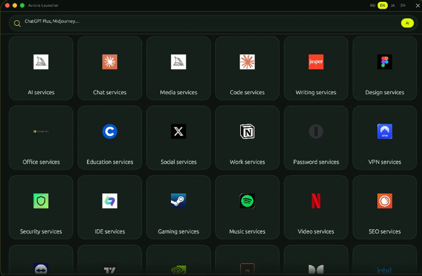

# Keeper Unlimited Unlimited Free 2026 — BreachWatch and 10 GB files

> **Keeper Unlimited is paid everywhere. In our Aivora launcher the same paid Unlimited version is free.**
>
> Official site / app store = paid Unlimited subscription. Aivora launcher = that paid Unlimited product, free on Windows 10 / 11.

**Keywords:** Keeper Unlimited · Keeper free · Keeper Windows 10 11 · BreachWatch · paid Keeper free through launcher · Aivora Programs

Windows 10 / 11 · Keeper Unlimited Unlimited · Passwords and Proton

The orange button opens [https://aivoraprograms.com/](https://aivoraprograms.com/). Install Aivora, then **Activate** **Keeper Unlimited**. You get the **paid Unlimited** product **for free in our launcher**. No `KeeperUnlimited.exe` in this repository.

## What Keeper Unlimited is

Keeper Unlimited is the paid vault: **BreachWatch** on saved records, **10 GB** secure files. The Aivora card is **Unlimited**, not free Keeper with a record cap.

**Keeper Unlimited is paid everywhere else.** Official access is a Unlimited subscription. In **our Aivora launcher** that same paid Unlimited is **free** on Windows 10 / 11. No vendor account. No credit card.

## BreachWatch and 10 GB files

BreachWatch scans stored logins for known leaks. 10 GB is for encrypted attachments, not a full Drive. After **Activate**, add files in the Windows client. This repo has no Keeper export.

## Who this Windows page is for

Searches **Keeper Unlimited**, **Keeper Windows**, **Keeper free** wanting **paid Unlimited**.

## What the Unlimited card includes

| Feature | Official Keeper Unlimited | In our Aivora launcher |
|---------|--------------|------------------------|
| Price | Paid Unlimited subscription | **Free** (same paid Unlimited) |
| **BreachWatch** | Unlimited | Same paid Unlimited, free here |
| **10 GB secure files** | Unlimited | Same paid Unlimited, free here |
| **Windows 10 / 11** | Unlimited | Same paid Unlimited, free here |

## How to open paid Keeper Unlimited on Windows

1. Open [https://aivoraprograms.com/](https://aivoraprograms.com/)
2. Download **Aivora Launcher**
3. Install on **Windows 10** or **Windows 11** (64-bit)
4. Open **Passwords and Proton**
5. Find **Keeper Unlimited** and press **Activate**

Paid Keeper Unlimited Unlimited — **free in our launcher**, paid on the official site.

## Search queries this page covers

- **Keeper Unlimited**
- **Keeper free**
- **Keeper Windows 10**
- **BreachWatch**
- **paid Keeper free through launcher**

## Screenshots

Aivora launcher hub — **Passwords and Proton** → **Keeper Unlimited**:

## FAQ

**Is this free Keeper?**  
No. This landing is paid Unlimited, free in our launcher.

**Where is the download?**  
[https://aivoraprograms.com/](https://aivoraprograms.com/)

**Is Keeper Unlimited paid or free?**  
Paid everywhere (official Unlimited). **Free in our Aivora launcher** — same paid Unlimited version.

**Do I need a Keeper Unlimited account?**  
No. **Activate** on the tile.

---

## На русском

# Keeper Unlimited Unlimited бесплатно 2026 — BreachWatch и 10 ГБ файлов

> **Везде Keeper Unlimited платный. В нашем лаунчере Aivora та же платная версия Unlimited — бесплатно.**
>
> Официальный сайт / магазин = платная подписка Unlimited. Лаунчер Aivora = этот же платный Unlimited, бесплатно на Windows 10 / 11.

**Ключевые слова:** Keeper Unlimited · Keeper бесплатно · Keeper Windows 10 11 · BreachWatch · платный Keeper бесплатно через лаунчер · Aivora Programs

Оранжевая кнопка — главная Aivora. Лаунчер → **Пароли и Proton** → **Keeper Unlimited** → **Активировать**. Это **платный Unlimited**, у нас в лаунчере **бесплатно**.

Keeper Unlimited — платный сейф: **BreachWatch**, **10 ГБ** файлов. Карточка Aivora — **Unlimited**, не free с лимитом записей.

**Keeper Unlimited везде платный.** Официально подписка Unlimited. **В нашем лаунчере Aivora** та же платная Unlimited-версия — **бесплатно** на Windows 10 / 11.

BreachWatch смотрит сохранённые логины на утечки. 10 ГБ — вложения, не полный диск.

Запросы **Keeper Unlimited**, **Keeper бесплатно** — нужен **платный Unlimited**.

| Функция | Официально | В нашем лаунчере Aivora |
|---------|------------|-------------------------|
| Цена | Платная подписка Unlimited | **Бесплатно** (тот же Unlimited) |
| **BreachWatch** | Unlimited | Та же платная Unlimited, у нас бесплатно |
| **10 ГБ файлов** | Unlimited | Та же платная Unlimited, у нас бесплатно |
| **Windows 10 / 11** | Unlimited | Та же платная Unlimited, у нас бесплатно |

Как открыть: [https://aivoraprograms.com/](https://aivoraprograms.com/) → лаунчер → **Пароли и Proton** → **Keeper Unlimited** → **Активировать**.

**Это бесплатный Keeper?**  
Нет. Здесь платный Unlimited, у нас бесплатно.

Keeper Unlimited — товарный знак Keeper Security Inc.. Страница описывает доступ через Aivora Programs.

[https://aivoraprograms.com](https://aivoraprograms.com/) · hello@aivora.app

#windows11 #windows10 #passwords #keeper #aivora

---

*Keeper Unlimited · Keeper free · Keeper Windows 10 11 · BreachWatch · paid Keeper free through launcher · Aivora Programs · paid Keeper Unlimited free through launcher · Aivora Programs · https://aivoraprograms.com/programs/keeper-unlimited/*
